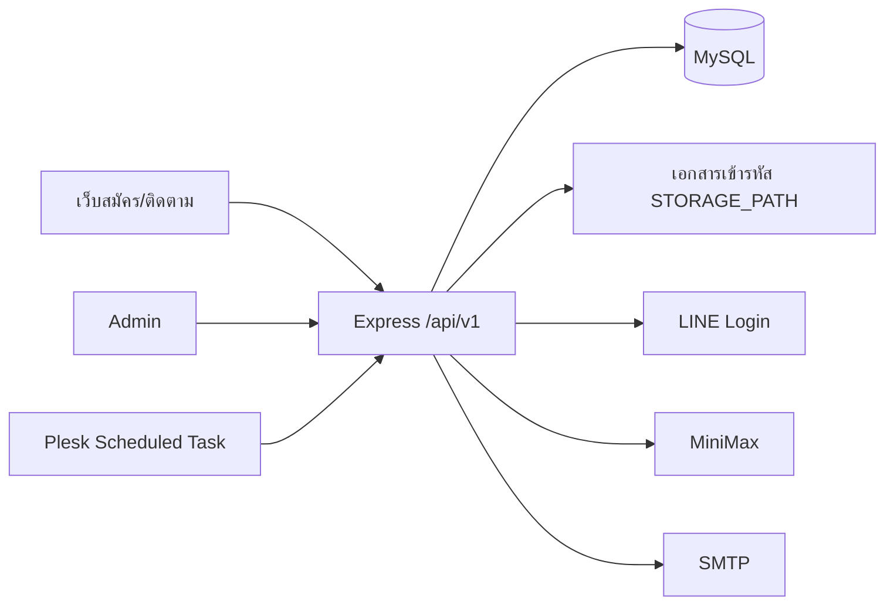

# สถาปัตยกรรม

`routes → controllers → services → repositories` และ `integrations/` สำหรับบริการภายนอก

## การตัดสินใจสำคัญ
- **ระบบนี้คือแหล่งข้อมูลหลัก** ไม่มีเว็บเดิม รอบถัดไปใช้ `applicants`, `applications`, `training_sessions` ชุดนี้
- **โดเมนเดียว** frontend และ API ไม่ใช้ CORS
- **Passenger อาจปิดโปรเซส** จึงไม่ใช้ node-cron ให้ Plesk เรียก `/internal/jobs/run` ล็อกงานและคิวอยู่ใน DB
- **เลขบัตร/เลขภาษี/เอกสาร/API key** เข้ารหัส AES-256-GCM (ผูก AAD กับที่ใช้งาน) ค้นหาเลขบัตรด้วย HMAC
- **บุคคลแยกจากใบสมัคร** การสมัครซ้ำไม่ทับข้อมูลเดิม
- **LINE ผูกกับบุคคลหลังเอกสารผ่านเท่านั้น** ก่อนหน้านั้นเห็นเฉพาะใบที่ตนส่งหรือยืนยันได้ กันคนใช้เลขบัตรผู้อื่นสมัครดัก
- **ทุกการเปลี่ยนสถานะเขียน `domain_events`** ใน transaction เดียวกัน เป็นต้นทางของการแจ้งเตือน LINE
- **API key ตั้งจากหน้า Admin ได้** (ผู้ว่าจ้างสั่งเปลี่ยนจากแผนเดิมที่ใช้ `.env` อย่างเดียว) ค่าใน DB มาก่อน `.env`
- `package.json` และ `app.cjs` อยู่ที่ราก ต่างจาก PART 13 เพราะข้อกำหนดของ Plesk
- ภาพถ่ายหน้าตรงรับเฉพาะ JPG/PNG เพราะต้องใช้บนใบประกาศ
